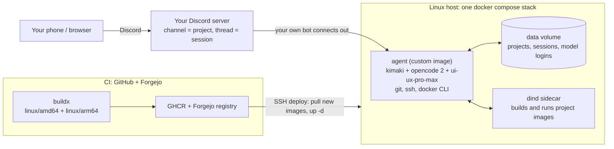

# sha2lato

> **Your AI dev team, one Discord message away.**

A self-hosted coding-agent box. [Kimaki](https://kimaki.dev) turns Discord into the control surface for [OpenCode 2](https://opencode.ai): every **channel is a project**, every **thread is a coding session**. Change a feature from your phone on the train, review the diff at lunch, merge the worktree before dinner — the agent runs the tests and builds the images on a machine you own.

Ships as one small repo: **one custom Docker image** (Kimaki + OpenCode 2 + the [ui-ux-pro-max](https://github.com/nextlevelbuilder/ui-ux-pro-max-skill) design skill + git/ssh/Docker tooling) wired together with official images via Docker Compose, with CI on GitHub **and** Forgejo that builds multi-arch images and deploys them over SSH.

## What you get

- 🎛️ **Discord as your control surface** — channels are projects, threads are sessions; search, resume, fork, `/diff`, `/btw`, queue, voice notes
- 🧠 **The models you already pay for** — run `/login` in Discord and use Claude Pro/Max, ChatGPT, Gemini, or API keys
- 🐳 **Docker-in-Docker included** — the agent can build **and run** images for Docker-based projects, isolated from the host
- 🎨 **Design intelligence baked in** — `npm i` a UI and the agent pulls the full ui-ux-pro-max skill suite (styles, palettes, fonts, stack guides)
- 🧭 **Workflow packs, on by default** — [agents-opencode](https://agnts.elkodr.com) (agent roster + slash commands) ships enabled; one env var switches to [Superpowers](https://github.com/obra/superpowers) or `none` — and pins any version (`agents-opencode@3.0.0`, `superpowers@v7.0.0`)
- ⚡ **Discipline + code intelligence** — [ponytail](https://github.com/DietrichGebert/ponytail) (minimal-code reviews) and [graphify](https://github.com/Graphify-Labs/graphify) (queryable knowledge graphs of any repo) are on by default and toggleable
- 🔐 **Self-hosted everything** — your bot identity, your machine, your git hosts (Forgejo, GitHub, or both)
- 🚀 **CI/CD included** — multi-arch images (`linux/amd64` + `linux/arm64`) published to GHCR and/or your Forgejo registry, deployed over SSH, rebuilt weekly for CVE freshness
- 🍴 **Fork-friendly** — zero personal values in the repo; everything lives in gitignored `*.env` files documented by committed `*.example` templates

## Architecture

## Quickstart (about 10 minutes)

1. **Get a Linux box with Docker** — any VPS, home server, or a fresh Azure VM ([docs/hosting.md](docs/hosting.md)).
2. **Bootstrap it**: `sudo ./deploy/bootstrap-host.sh <your-fork-url>` ([docs/hosting.md](docs/hosting.md)).
3. **Create your Discord bot** (own identity, 5 minutes — [docs/discord-bot.md](docs/discord-bot.md)), then run `./deploy/configure.sh` on the host: it asks for the token and (optionally) a workflow pack.
4. **Start it** (build-on-host mode): `docker compose -f compose/docker-compose.yml up -d --build` — or pull the CI-published image ([deployment modes](docs/configuration.md#deployment-modes))
5. **Invite the bot**: `docker compose -f compose/docker-compose.yml exec agent kimaki bot install-url` → open the URL → authorize → `docker compose restart agent`
6. In Discord: run `/login` to connect a model, then just talk to your agent. Tell it to `git clone` a repo into `/data/projects/…` and add it as a project — a new channel appears.

Full walkthroughs: [docs/](docs/README.md).

## Documentation

| Scope | Doc |
|---|---|
| Hosting — any Docker host or an Azure VM | [docs/hosting.md](docs/hosting.md) |
| Self-hosting your Discord bot | [docs/discord-bot.md](docs/discord-bot.md) |
| Secrets, SSH keys, fork guide | [docs/secrets.md](docs/secrets.md) |
| Configuration — every knob in one place | [docs/configuration.md](docs/configuration.md) |
| CI/CD — both pipelines, registries, deploys | [docs/ci-cd.md](docs/ci-cd.md) |
| Upstream index — every dependency + how it updates | [docs/upstreams.md](docs/upstreams.md) |
| Using it from your phone (day 2) | [docs/usage.md](docs/usage.md) |
| Optional self-hosted GitHub runner | [docs/github-runner.md](docs/github-runner.md) |
| Running it under a UI (Arcane) | [docs/arcane.md](docs/arcane.md) |
| Troubleshooting | [docs/troubleshooting.md](docs/troubleshooting.md) |

## Fork it

Everything personal is externalized: no tokens, keys, usernames or hosts live in this repo.

1. **Fork** → push to your GitHub (and/or Forgejo).
2. **Copy the templates**: `cp secrets/.env.agent.example secrets/.env.agent`, `cp compose/.env.example compose/.env` → fill in your bot token and (optionally) your registry image.
3. **Wire CI** (optional): set `DEPLOY_SSH_*` repo secrets to enable auto-deploy; the pipelines stay green without them and publish images for forks as-is ([docs/ci-cd.md](docs/ci-cd.md)).
4. **Invite your own bot** — you never share bot identities with anyone ([docs/discord-bot.md](docs/discord-bot.md)).

## Requirements

- A Linux host with Docker Engine 25+ (2–4 GB RAM is comfortable) and SSH access
- A Discord account (the bot is yours — created in 5 minutes, no bot marketplace needed)
- Optional for fresh machines: Ubuntu/Debian — `deploy/bootstrap-host.sh` handles the rest

## License

MIT — see [LICENSE](LICENSE).
